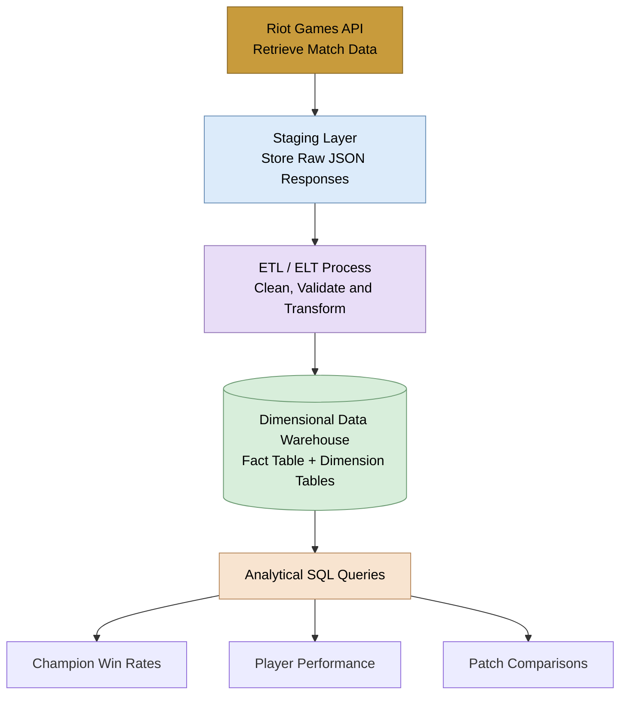

# League of Legends Match Data Warehouse

Author: Le Dinh Trung Tin  
Neptun: L94273  
Supervisor: Anett Lenart  
Project ID: 2026-LA-02

---

## Problem

-League of Legends generates large amounts of match data, which can be used to analyze gameplay statistics and historical trends.

-Raw data retrieved from the Riot Games API may contain complex JSON, so collecting, cleaning, and organizing data from many matches consistently is necessary for reliable historical analysis.

>This project aims to build a data warehouse that collects match data from the Riot Games API, preserves raw responses in a staging layer, and transforms them into a structured dimensional model. The resulting warehouse will support historical and comparative analysis through SQL queries.

## Target users

| **Role** | **Needs** | **Interaction** |
|---|---|---|
| **Data analyst / researcher** | Analyze champion performance, player statistics, and historical gameplay trends | Run analytical SQL queries and compare results across patches, roles, and time |
| **Data engineer / database developer** | Ensure reliable data collection, transformation, storage, and query performance | Manage data pipelines, validate records, and inspect database performance |

## Planned scope

### In scope

- Collect match data from the Riot Games API and preserve raw responses in a separate staging layer.
- Implement an ETL or ELT pipeline for data cleaning, standardization, key management, and incremental loading.
- Design a dimensional data warehouse with at least one central fact table and multiple dimension tables, explicitly defining the fact table grain.
- Support analysis by player, champion, time, patch, role, and match type, where the required data is available.
- Build a test dataset containing at least several hundred thousand matches and several million fact records, as required by the project specification.
- Develop at least 10 complex analytical SQL queries covering temporal aggregation, champion and role comparisons, win-rate and pick-rate analysis, player performance, and patch comparisons.
- Compare star and snowflake schemas and examine at least two historization approaches, justifying the selected design.
- Measure and optimize at least five selected analytical queries, documenting performance before and after optimization.
- Document data quality, API limitations, error handling, and the reproducibility of the data-loading process.

### Out of scope

- Developing a dedicated website, interactive dashboard, or mobile application.
- Guaranteeing complete coverage of every League of Legends match across all regions and time periods.
- Implementing predictive analytics or a real-time match analysis service.

### Planned data flow

## Initial user journeys

### 1. Collecting match data

1. The data engineer starts the data collection process.
2. The system retrieves match data from the Riot Games API and stores the raw responses in the staging layer.
3. The pipeline validates the data, identifies duplicates, and records collection errors.

**Result:** Raw match data is available for processing and incremental loading.

### 2. Analyzing match data

1. An analyst wants to compare a champion's performance across patches and roles.
2. The analyst runs an SQL query against the data warehouse.
3. The query calculates statistics such as match counts and win rates.

**Result:** The analyst can compare champion performance and explore historical trends.

### 3. Checking data quality

1. The data engineer wants to verify the consistency of the warehouse.
2. The engineer runs checks for missing values, duplicate records, and invalid relationships between fact and dimension tables.
3. The pipeline records detected issues for investigation.

**Result:** Potential data quality problems can be identified before they affect analytical results.

## Next steps

- Review the Riot Games API documentation, available endpoints, rate limits, and data-discovery options.
- Test data collection with a small sample and evaluate the feasibility of reaching the required dataset size.
- Inspect the API response structure and identify the fields needed for analysis.
- Define the fact table grain and design an initial dimensional data model.
- Compare star and snowflake schemas and investigate suitable historization approaches.
- Evaluate database technologies and implementation options.
- Implement the initial data-loading pipeline and prepare analytical SQL queries.
- Establish a method for measuring and documenting query performance before and after optimization.