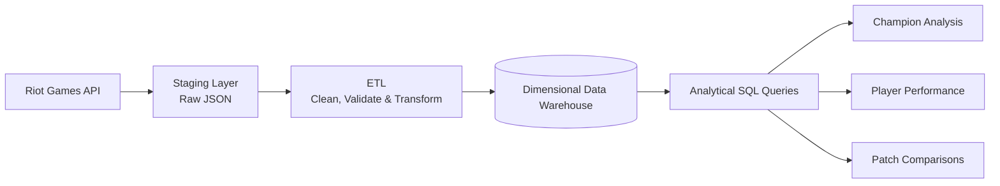

# League of Legends Match Data Warehouse

**Author:** Le Dinh Trung Tin  
**Neptun:** L94273  
**Supervisor:** Anett Lenart  
**Project ID:** 2026-LA-02

---

---

## Problem

- League of Legends generates large amounts of match data for historical gameplay analysis.
- Raw Riot Games API data requires structured storage, cleaning, and transformation.

**Goal:** Build a data warehouse for reliable historical and comparative analysis using SQL.

---

## Target users

| Role | Main needs |
|---|---|
| Data analyst / researcher | Analyze champions, players, roles, and patches |
| Data engineer / database developer | Manage data pipelines, quality, and performance |

---

## Planned scope

### In scope

- Collect Riot API data and preserve raw JSON in staging.
- Build an ETL/ELT pipeline with incremental loading.
- Design a dimensional warehouse with a clearly defined fact table grain.
- Analyze players, champions, roles, patches, and time.
- Process several hundred thousand matches and several million fact records.
- Develop **at least 10 analytical SQL queries**.
- Compare star vs. snowflake schemas and **at least 2 historization approaches**.
- Measure and optimize **at least 5 queries**.

---

### Out of scope

- Dedicated website, dashboard, or mobile app.
- Complete coverage of every match.
- Predictive analytics and real-time analysis.

---

## Planned data flow

---

## Initial User Journeys

### 1. Compare Champion Performance Across Patches
1. Select a champion and two game patches.
2. Compare win rates and match counts.
3. Identify changes in champion performance.

**Expected result:** Understand how champion performance changes between patches.

---

### 2. Verify the Reliability of Statistics
1. Select a statistic, such as a champion's win rate.
2. Check the number of matches and the dataset scope.
3. Consider data limitations before drawing conclusions.

**Expected result:** Interpret statistical results more carefully.

---

### 3. Analyze Player Performance Over Time
1. Select a player and a time period.
2. Examine match statistics, such as kills, deaths, and assists.
3. Compare the player's performance across different periods.

**Expected result:** Identify historical patterns in player performance.

---

## Next steps

- Explore the Riot API and test data collection.
- Define the fact table grain and dimensional model.
- Compare schemas and historization approaches.
- Implement and validate the data pipeline.
- Develop analytical queries and optimize performance.

---