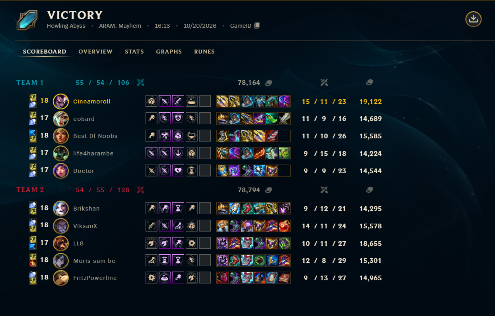
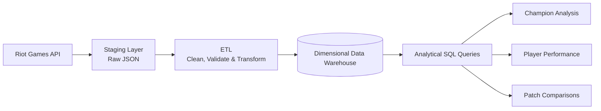

# League of Legends Match Data Warehouse

**Author:** Le Dinh Trung Tin  
**Neptun:** L94273  
**Supervisor:** Anett Lenart  
**Project ID:** 2026-LA-02

---

---

## Problem

- League of Legends generates large amounts of match data for historical gameplay analysis.
- Raw Riot Games API data requires structured storage, cleaning, and transformation.

**Goal:** Build a data warehouse for reliable historical and comparative analysis using SQL.

---

## Target users

| Role | Main needs |
|---|---|
| Data analyst / researcher | Analyze champions, players, roles, and patches |
| Data engineer / database developer | Manage data pipelines, quality, and performance |

---

## Planned scope

### In scope

- Collect Riot API data and preserve raw JSON in staging.
- Build an ETL/ELT pipeline with incremental loading.
- Design a dimensional warehouse with a clearly defined fact table grain.
- Analyze players, champions, roles, patches, and time.
- Process several hundred thousand matches and several million fact records.
- Develop **at least 10 analytical SQL queries**.
- Compare star vs. snowflake schemas and **at least 2 historization approaches**.
- Measure and optimize **at least 5 queries**.

---

### Out of scope

- Dedicated website, dashboard, or mobile app.
- Complete coverage of every match.
- Predictive analytics and real-time analysis.

---

## Planned data flow

---

## Initial user journeys

### 1. Collect match data
1. Retrieve match data through the Riot API.
2. Store raw responses in staging.
3. Validate and load data into the warehouse.

**Result:** Data ready for analysis.

---

### 2. Analyze match data
1. Select champions, roles, or patches to compare.
2. Run analytical SQL queries.
3. Examine match statistics and win rates.

**Result:** Historical gameplay insights.

---

### 3. Check data quality
1. Check for missing, duplicate, or invalid data.
2. Validate warehouse relationships.
3. Review data issues and query performance.

**Result:** Reliable data and measurable performance.

---

## Next steps

- Explore the Riot API and test data collection.
- Define the fact table grain and dimensional model.
- Compare schemas and historization approaches.
- Implement and validate the data pipeline.
- Develop analytical queries and optimize performance.

---